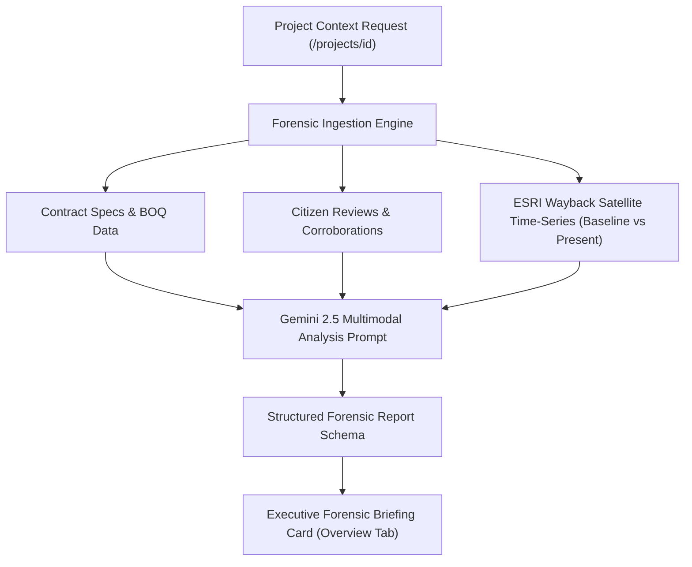

# MAPATUNAI Platform Refactor Specification & Architecture Design

**Date:** 2026-10-09  
**Status:** Approved  
**Author:** Pair Programming Team  

---

## 1. Executive Summary & Goals

This specification outlines the comprehensive refactoring of the **MAPATUNAI** civic infrastructure tracking platform. The goal is to strip away visual clutter and redundant modules, resolve critical Mapbox engine lifecycle and filtering bugs, establish a streamlined contractor project navigation workflow, and embed an advanced **AI Forensic Analysis Pipeline** anchored directly alongside a large-scale, interactive satellite timeline in the project overview.

---

## 2. UI Deletions & Deprecations

### 2.1 Global Header (`src/components/header.tsx`)
- **Remove**: The `Home` text link.
- **Remove**: The `Launch Map →` button/CTA.
- **Retain**: 
  - Clickable `MAPATUNAI` logo linking directly to `/`.
  - `Contractors` link navigating to `/contractors`.

### 2.2 Interactive Map HUD (`src/app/map/components/DrillDownPanel.tsx`)
- **Remove**: The embedded `MAPATUNAI` logo pill.
- **Remove**: All 7 anomaly filter chips (`ALL`, `OVERDUE`, `STALLED`, `GHOST RISK`, `NOT STARTED`, etc.).
- **Retain**:
  - In-HUD Search bar (multi-region, ID, and keyword querying).
  - In-HUD "Near Me" GPS Radar button.
  - Basemap style toggle capsule (`SAT`, `DARK`, `TERR`).
  - Total points counter pill.
  - Hierarchical location selectors (Region > Province > Municipality / City > Barangay).

### 2.3 Project Dossier (`src/app/projects/[id]/page.tsx`)
- **Consolidate Tabs**: Reduce tabs strictly to **Overview** and **Citizen Reports** (`CommunityTab`).
- **Remove Modules & Tabs**:
  - `DPWH Civil Works Registry` external button.
  - `File FOI Request` button.
  - `NewsTab` (News & Media tab) — completely pruned from UI.
  - `FinancialsTab` (Financials & BOQ tab) — completely pruned from UI.
  - `ConnectionsTab` (Alliance & Network tab) — completely pruned from UI.
  - Active Workers on Site vote card from `CommunityTab`.
  - Anti-fraud Phone Verification UI from `CommunityTab`.
  - Redundant Disbursement vs. Physical Progress Alignment card from `OverviewTab`.
  - Primary Contractor card from `OverviewTab` (relocate the contractor full profile link directly to the project title header block).

---

## 3. Map, Geolocation & Filtering Bug Fixes

### 3.1 Theme Switching State Persistence
- **Root Cause**: Mapbox GL's `map.setStyle()` wipes all custom sources and layers. In `src/app/map/page.tsx`, `setupLayers()` was only attached to `map.on('load')`, which only fires on initial map mounting. Switching basemaps removed all pin layers and cluster sources permanently.
- **Architecture Fix**:
  - Centralize layer registration into `mountLayers()`.
  - Bind `mountLayers()` to `map.on('style.load')`.
  - Re-add GeoJSON sources (`supercluster-source`, `selected-boundary-source`, `selected-mask-source`, `choropleth-source`) and their corresponding layer stacks on every style swap.
  - Immediately trigger `renderClusters()` upon `style.load` to restore active clusters without dropping pins.

### 3.2 City & Province Viewport & Pin Restriction
- **Root Cause**: `src/app/map/workers/cluster.worker.ts` ignored municipality drill-down filters, and `src/app/map/page.tsx` omitted `municipality` from `applyFilters`.
- **Architecture Fix**:
  - In `cluster.worker.ts`, add support for filtering by `municipality`:
    - When `filters.province` is provided, filter `currentFeatures` by matching province index `v === targetProvinceIdx`.
    - When `filters.municipality` is provided, filter `currentFeatures` where project title `p.n.toLowerCase().includes(filters.municipality.toLowerCase())` or within target municipality bounding box.
  - In `page.tsx`, pass `drillDown.province` and `drillDown.municipality` into `applyFilters` and automatically trigger `fitBounds(boundary.bounds)` to strictly frame the target locality.

### 3.3 Regional Border Rendering Fix
- **Root Cause**: In `src/app/api/locations/boundary/route.ts`, database region names (e.g., `Region IV-B (MIMAROPA)`, `Bangsamoro Autonomous Region in Muslim Mindanao (BARMM)`) failed string equality checks against `public/geo/regions.json` properties (e.g., `MIMAROPA Region`).
- **Architecture Fix**:
  - Add canonical mapping dictionary in `boundary/route.ts`:
    - `Region IV-B (MIMAROPA)` &rarr; `MIMAROPA Region`
    - `Region I (Ilocos Region)` &rarr; `Region I (Ilocos Region)`
    - `Cordillera Administrative Region (CAR)` &rarr; `Cordillera Administrative Region (CAR)`
    - `Bangsamoro Autonomous Region (BARMM)` &rarr; `Bangsamoro Autonomous Region In Muslim Mindanao (BARMM)`
    - `National Capital Region (NCR)` &rarr; `National Capital Region (NCR)`
  - Normalize strings prior to lookup, ensuring 100% of the 17 Philippine administrative regions highlight correctly.

### 3.4 Cluster Size Optimization
- **Supercluster Worker**: Reduce clustering radius from `75` to `45`.
- **Mapbox Circle Layers**:
  - Outer glow radius: scaled down from `24-56px` to `14-28px`.
  - Core blob radius: scaled down from `18-44px` to `11-22px`.
  - Stroke width: reduced to `1.5px` with crisp white border.
  - Prevents clusters from visually dominating provinces and obscuring roadway features.

### 3.5 Global Multi-Region Search Fix
- **Root Cause**: `src/app/api/projects/route.ts` only searched `name`, `id`, `contractorRaw`, and `province.name`. Searching for "NCR", "Central Luzon", or composite multi-word terms returned zero results.
- **Architecture Fix**:
  - Update `where.OR` in `/api/projects` Prisma query to include:
    - `province: { region: { name: { contains: q, mode: 'insensitive' } } }`
    - `category: { contains: q, mode: 'insensitive' }`
    - Tokenized search: split multi-word queries so queries like "Cebu Bridge" match projects in Cebu province with "Bridge" in their name.

### 3.6 "Near Me" Geolocation, Radar Marker & Visual Radius
- When the user clicks **Near Me**:
  1. Retrieve live coordinates via `navigator.geolocation.getCurrentPosition`.
  2. Fly smoothly to coordinates (`zoom: 13.5`).
  3. Draw a dynamic circular GeoJSON polygon centered at user `[lng, lat]` with a radius of **5.0 km** (`#01367d` stroke, `rgba(1, 54, 125, 0.15)` fill).
  4. Display an active distance badge over the map: `SEARCH RADIUS: 5.0 KM (SCANNING NEARBY INFRASTRUCTURE)`.

---

## 4. UI/UX Layout & Navigation Updates

### 4.1 Large-Scale Live Satellite Timeline in Overview Tab
- **Placement**: Transferred directly into `OverviewTab.tsx` as the central visual evidence anchor.
- **Scale**: Expanded to full width and **520px height**.
- **Interactive Scrubber**:
  - Horizontal timeline scrubber from **Baseline (Project Start Year)** to **Present (2026)**.
  - Smooth tile swapping referencing ESRI World Imagery Wayback raster endpoints.
  - Real-time GPS coordinate badge and capture date display.
  - Side-by-side split compare button directly on the viewer.

### 4.2 Contractor Won Projects Slide-Over Drawer
- **Location**: `src/app/contractors/page.tsx`.
- **Trigger**: Clicking **"View Projects →"** on any contractor card.
- **Behavior**:
  - Opens an in-page slide-over drawer on the right side without navigating away.
  - Queries `/api/projects?q=${contractorName}&limit=50`.
  - Lists each won contract with title, contract ID, allocated budget, physical progress, and location.
  - **Direct Redirect**: Clicking any project inside the drawer calls `router.push(/projects/${id})` directly.

---

## 5. AI Forensic Analysis Pipeline Specification

### 5.1 Pipeline Flow


### 5.2 API Endpoint: `/api/ai/forensic-audit`
- **Method**: `POST`
- **Request Body**: `{ "projectId": string }`
- **Processing**:
  1. Ingests contract allocation, amount disbursed, claimed physical progress, and start/completion dates.
  2. Aggregates community whistleblower feedback, worker activity reports, and photo corroborations.
  3. Evaluates GPS satellite temporal change (earthmoving, structural paving, or lack of progress).
  4. Compiles structured JSON response and caches in PostgreSQL `project.aiSummary` / forensic fields.

### 5.3 Report Schema
```typescript
interface ForensicAuditReport {
  executiveSummary: string;
  temporalComparison: {
    baselineYear: number;
    presentYear: number;
    observedChanges: string;
    satelliteConfidencePct: number;
  };
  discrepancyAudit: {
    financialPayoutPct: number;
    claimedPhysicalPct: number;
    deltaGapPct: number;
    accelerationWarning: boolean;
  };
  riskTier: 'LOW' | 'MODERATE' | 'HIGH' | 'CRITICAL';
  complianceStatus: 'VERIFIED' | 'UNDER_REVIEW' | 'FLAGGED_ANOMALY';
  actionableRecommendations: string[];
}
```

### 5.4 Presentation in `OverviewTab.tsx`
- Displayed as the **AI Forensic Executive Briefing** card.
- Styled in the homepage aesthetic: Deep Navy (`#011438`), Royal Blue (`#01367d`), Gold (`#ffb241`), and clean monospace status badges. Zero emojis.

---

## 6. Verification & Quality Gates
- **TypeScript Compilation**: `npx tsc --noEmit` must exit with 0 errors.
- **Production Build**: `npx next build` must compile and prerender all 28 static and dynamic routes with code 0.
- **Interactive Verification**:
  1. Global Header contains only `MAPATUNAI` logo and `Contractors`.
  2. Map HUD contains only search, Near Me, basemaps, and location dropdowns; zero emojis.
  3. Switching themes (`satellite` &rarr; `dark` &rarr; `streets`) preserves all pin clusters.
  4. Selecting a municipality/province restricts pins strictly to that locality.
  5. Selecting MIMAROPA or BARMM renders their highlighted boundary polygon.
  6. Clicking "View Projects" on a contractor opens the in-page slide-over drawer; selecting a project routes to `/projects/[id]`.
  7. Detailed project page contains only Overview and Citizen Reports tabs; Overview features the large 520px satellite timeline and structured AI Forensic Audit report.
